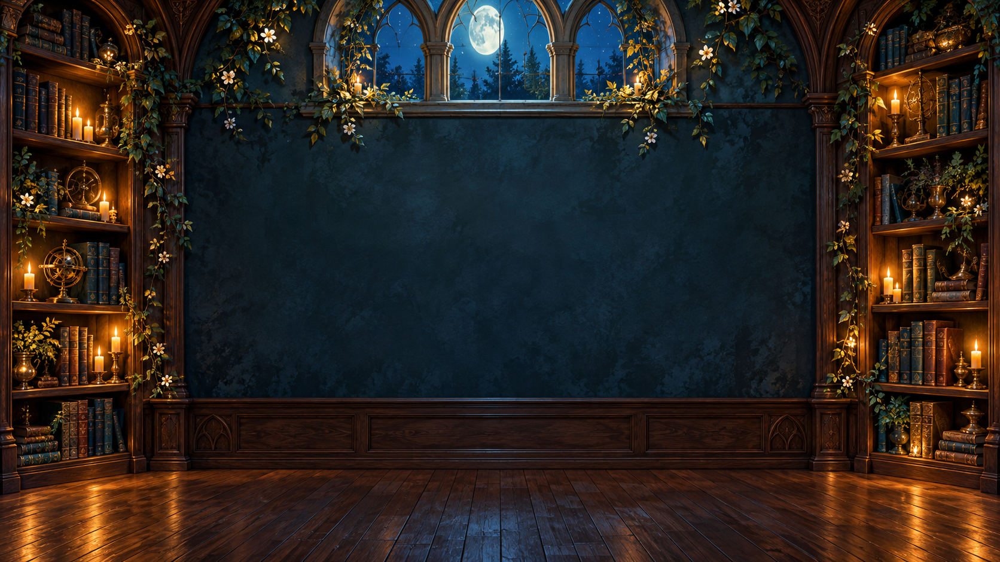

# めざめる物語の台地 / Enchanted Storybook Plateau

Azure KinectとUnityでつくる、物語の台地にいる動物へ手を伸ばすインタラクティブ展示です。
額縁や夜の壁画は表示せず、塗り絵の動物が明るい風景の中でそのまま息づき、手でなぞった道を追いかけます。

## 拡張プロトタイプ

この版では、元の魔法図書館と同じ青緑・金・植物・古い魔法の世界観を保ちながら、舞台を明るい朝の広い台地へ拡張しています。`Magic/PlateauDay` がない場合は、昼の図書館、元の夜の図書館の順に自動で戻ります。

- 動物の種類・速度・大きさ・アニメーション素材を `AnimalCatalog.cs` に集約
- ネコ、イヌ、トリ、ワニの追加プロフィールを用意
- 台地にいるネコへ触れ、同じ塗り絵のまま移動・猫じゃらし反応を再生
- ゆっくり動かす「撫でる」、左右に振る「誘う」、静止する「待つ」を共通判定
- 既存のフクロウとキツネの追従・帰還はプロフィール方式へ移行
- `ImagePipeline/output` の最新 `*_transparent.png` を監視し、ネコの塗り絵へ自動反映

特殊行動用の画像がまだない動物は、通常画像へ自動的にフォールバックします。新しい動物は `AnimalCatalog` のプロフィールと `Assets/Resources/Magic/` の画像を追加するだけで接続できます。



## 体験

- 開いた手のひらを動物に約0.5秒重ねると、動物が目覚めて淡い光が広がります。
- フクロウは羽ばたき、キツネは跳ねながら手の道を追います。左右の手に対応しています。
- 動物は約10秒で台地の元の場所へ戻ります。再び触れると呼び出せます。
- 自分のシルエットは半透明の黒。動物は触れる前から明るい台地に表示されます。
- 得点や制限時間は設けず、触れる・描く・待つ・眺める体験を中心にしています。

## ダウンロードと起動

このリポジトリは、フォルダー構造を保った **EnchantedSilhouetteLibrary-UnityProject.zip** と導入手順を公開しています。
ZIPをダウンロードして展開してください。Unityプロジェクトのルートは展開後の `UnityProject` です。

1. Windows x64、Unity **6000.6.4f1**、Azure Kinect DK、USB 3.0と別系統の電源を用意します。Meta Questは使いません。
2. [Microsoft公式のAzure Kinect Sensor SDK](https://github.com/microsoft/Azure-Kinect-Sensor-SDK/releases/tag/v1.4.2)をインストールします。
3. Unityを開く前に、展開フォルダーの `Setup-Dependencies.ps1` をPowerShellで実行します。

   ```powershell
   .\Setup-Dependencies.ps1
   ```

   スクリプトはインストール済みSDKから必要なDLLをコピーし、MediaPipe Unity Plugin 0.16.3、Googleの手モデル、Microsoftの.NETライブラリを公式配布元から取得します。MediaPipeと手モデルはSHA-256を照合します。
   実行ポリシー等で実行できない場合は、組織・PCの管理者の方針に従ってください。
4. Unity Hubで `UnityProject` を追加し、`Assets/Resonance.unity` を開いてPlayします。
5. **F1 →「背景を登録する（5秒後）」** を押し、5秒間カメラの外へ出ます。戻ったら2〜3m程度の位置で手を映してください。

## 操作

| 操作 | 内容 |
|---|---|
| 手のひらで動物に触れる | 動物を呼び出し、光のオーラが現れる |
| 手で空中に道を描く | 動物が道を順番に追いかける |
| 手を静かに止める | 動物が落ち着き、光がゆっくり漂う |
| F1 | 背景登録、距離、音量、マウス確認モード |
| R | 動物を元の場所へ戻してリセット |

このPCでは `C:\Users\Hinaho\My project\ImagePipeline\output` も自動検出します。別の場所を使う場合は、ビルドしたアプリの起動時に `-coloringOutput="出力フォルダー"` を追加するか、環境変数 `COLORING_OUTPUT_DIR` を設定してください。停止中は読み込んだ子供の塗り絵を表示し、移動中はその配色を反映した4コマ歩行画像へ切り替えます。

Playを停止すると背景登録は失われます。家具が影になる場合は、空の背景を登録し直してください。
マウス操作は起動時から有効です。動物をクリックしたままドラッグすると、すぐに起きてカーソルを追います。Kinectを使うときはF1設定で「マウス操作」をオフにしてください。

## 構成

- `Assets/Scripts/ExhibitionKinectInput.cs`: Azure Kinectの映像・深度入力
- `Assets/Scripts/MediaPipeGunPose.cs`: 両手・手のひらの取得（初期試作時のファイル名を保持）
- `Assets/Scripts/MagicLibrary.cs`: 動物の戻り場所と目覚めの反応
- `Assets/Scripts/AnimalCompanions.cs`: 動物の経路追従・帰還
- `Assets/Scripts/ExhibitionController.cs`: 展示表示・アニメーション・設定
- `Assets/Scripts/ColoringImportBridge.cs`: 写真処理済みPNGの監視・自動読込
- `Assets/Resources/Magic/`: 背景と動物の素材
- `COLORING_RIG_SPEC.md`: 塗り絵をそのまま動かす2Dリグの設計
- `ART_PROMPTS.txt`: 内蔵imagegenで作成した素材の生成プロンプト

## 依存ソフトと公開範囲

Microsoft Azure Kinect Sensor SDK、[MediaPipe Unity Plugin](https://github.com/homuler/MediaPipeUnityPlugin)、GoogleのHand Landmarkerモデル、Microsoft .NETライブラリを使用します。
これらのバイナリ・大容量パッケージはZIPに同梱せず、各配布元の利用条件で取得します。詳細は `THIRD_PARTY_NOTICES.md` を参照してください。
UnityのLibrary/Temp/Logs、ユーザー設定、認証情報、カメラ映像・録画、背景の深度データは含めていません。

## 確認状況と制限

C#コンパイルと経路追従・帰還・接触判定などの29項目を検証済みです。
実機での手の認識は照明、距離、設置位置に依存します。動物の動きは4コマの2Dスプライトです。
依存ファイルの取得スクリプトは、公開環境での全件新規ダウンロードをまだ検証していません。
公開だけで任意の再利用ライセンスを付与するものではありません。第三者の素材・ソフトウェアにはそれぞれの条件が適用されます。
